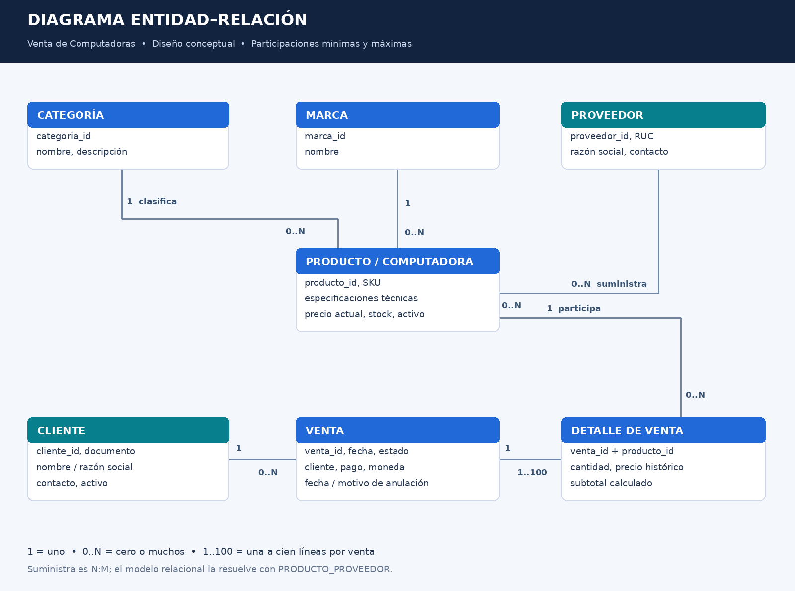
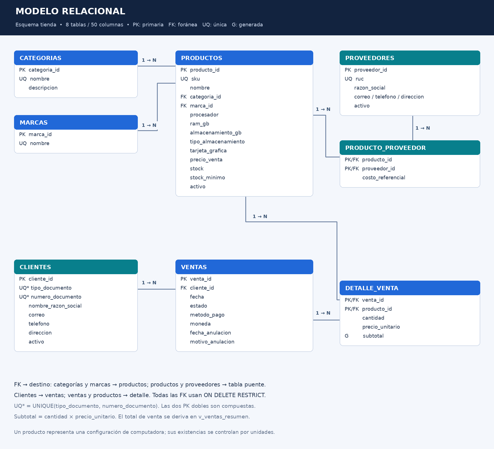

# Base de Datos — Venta de Computadoras

Diseño conceptual, lógico y físico de una base de datos relacional para una tienda de computadoras. Gestiona catálogo técnico, clientes, proveedores y ventas con control transaccional de existencias. Incluye documentación de rutas REST, consultas SQL y pruebas reproducibles.

| Identificación | Dato |
| --- | --- |
| Estudiante | Jean Piero Huamani Rodriguez |
| Carrera | Ingeniería de Sistemas e Informática |
| Asignatura | Ingeniería Web |
| Fecha de preparación | 27/10/2026 |
| Proyecto | Base de Datos - Venta de Computadoras |
| Motor | PostgreSQL 16 o superior |

> El motor se eligió porque la consigna no especifica uno; confirmar que coincida con lo indicado en clase.

## Alcance técnico

- Ocho tablas con claves primarias, foráneas, restricciones de dominio y unicidad.
- Cada producto representa una computadora de una configuración específica; el SKU distingue configuraciones. Las categorías iniciales son Laptop y Escritorio.
- Relación N:M entre productos y proveedores, resuelta con `producto_proveedor`.
- Ventas con una o más líneas. El precio se obtiene del catálogo al vender y se guarda en el detalle para conservar el importe histórico.
- Registro y anulación de ventas mediante funciones PL/pgSQL: descuento/devolución de stock y rollback integral ante un error.
- Totales derivados en una vista y subtotales generados, evitando mantener importes duplicados manualmente.
- Importes en PEN; precios finales de demostración. No se desglosan tributos ni se emiten comprobantes fiscales. Es un modelo académico.

Las rutas son un **contrato documentado para una futura API**. Este repositorio no incluye servidor HTTP ni interfaz web: el componente ejecutable es la base de datos. La consigna solicita el mapeo de rutas y las consultas/procedimientos del proceso de venta.

## Estructura

```text
README.md
docs/
  01_diseno_conceptual.md
  02_modelo_relacional.md
  03_diccionario_datos.md
  04_reglas_y_transacciones.md
  05_validacion.md
  06_fuentes.md
  diagramas/   # DER y modelo relacional en PNG, SVG y Mermaid
database/
  instalar.sql
  01_ddl.sql
  02_funciones.sql
  03_dml.sql
  04_consultas.sql
  05_pruebas.sql
  06_permisos_opcionales.sql
  07_pruebas_permisos_opcionales.sql
routes/
  endpoints.md
  openapi.yaml
entrega/
  GUIA_GITHUB_Y_MOODLE.md
  ENTREGA_MOODLE.txt
```

## Documentación del diseño

1. [Diseño conceptual y DER](docs/01_diseno_conceptual.md).
2. [Modelo relacional y normalización](docs/02_modelo_relacional.md).
3. [Diccionario completo de datos](docs/03_diccionario_datos.md).
4. [Reglas, transacciones y seguridad](docs/04_reglas_y_transacciones.md).
5. [Mapeo de endpoints a SQL](routes/endpoints.md) y [contrato OpenAPI](routes/openapi.yaml).
6. [Evidencia y alcance de validación](docs/05_validacion.md).

### Diagrama Entidad-Relación conceptual



### Modelo relacional



Los SVG y los archivos `.mmd` editables se encuentran junto a las imágenes.

## Instalación con PostgreSQL y psql

Requisitos: PostgreSQL 16 o superior instalado y en ejecución, cliente `psql` y un usuario propietario con permiso para crear una base de datos. En Windows, `psql` está en la carpeta `bin` de PostgreSQL; también puede abrirse mediante SQL Shell. No se requiere Node.js ni Python para utilizar los scripts.

Desde una terminal situada en la raíz del proyecto:

```bash
createdb -U postgres -E UTF8 venta_computadoras
psql -U postgres -d venta_computadoras -v ON_ERROR_STOP=1 -f database/instalar.sql
psql -U postgres -d venta_computadoras -v ON_ERROR_STOP=1 -f database/04_consultas.sql
psql -U postgres -d venta_computadoras -v ON_ERROR_STOP=1 -f database/05_pruebas.sql
```

Introducir la contraseña local cuando el cliente la solicite. Sustituir `postgres` por el usuario propietario configurado en tu instalación. Si el servidor no es local o usa otro puerto, añadir `-h HOST -p PUERTO` a los comandos. Si la base ya existe y está vacía, omitir `createdb`.

`instalar.sql` ejecuta DDL → funciones → DML. Cada archivo se ejecuta en una transacción. El esquema debe ser nuevo: los scripts no eliminan datos, no son una migración y no se deben repetir sobre una instalación completa. Para repetir la práctica, crear otra base vacía con un nombre distinto. Si un paso falló, corregir la causa antes de continuar; los pasos anteriores ya confirmados permanecen.

### Alternativa con pgAdmin

1. Crear una base de datos llamada `venta_computadoras` con codificación UTF8.
2. Abrir Query Tool en esa base.
3. Abrir y ejecutar **individualmente y en este orden** `01_ddl.sql`, `02_funciones.sql` y `03_dml.sql`.
4. Ejecutar `04_consultas.sql` para revisar el resultado y `05_pruebas.sql` para verificar las reglas.

No ejecutar `instalar.sql` en Query Tool: contiene metacomandos exclusivos de `psql`. El archivo de permisos es opcional y requiere un administrador; ver [seguridad](docs/04_reglas_y_transacciones.md).

## Operaciones de venta

```sql
-- El cliente solo envía IDs y cantidades; no controla el precio unitario.
SELECT tienda.registrar_venta(
  1, 'EFECTIVO',
  '[{"producto_id":1,"cantidad":1},{"producto_id":3,"cantidad":2}]'::jsonb
) AS venta_id;

-- Consultar la venta usando el ID DEVUELTO por la función anterior.
SELECT * FROM tienda.v_ventas_resumen ORDER BY venta_id DESC LIMIT 1;

-- Para anular: sustituir 1 por el ID real de la venta que se desea anular.
-- Esta operación conserva los detalles y devuelve las unidades al stock.
-- SELECT tienda.anular_venta(1, 'Solicitud del cliente');
```

La función se confirma al finalizar la sentencia cuando el cliente usa autocommit. Dentro de una transacción explícita, el llamador debe ejecutar `COMMIT` o `ROLLBACK`. La vista `v_ventas_resumen` incluye también las anuladas para trazabilidad; los reportes de ingresos deben filtrar `estado='CONFIRMADA'`.

## Datos iniciales esperados

Los datos y precios son ficticios, no cotizaciones comerciales. Hay 2 categorías, 4 marcas, 3 proveedores, 6 computadoras, 8 relaciones de suministro, 4 clientes, 3 ventas y 4 líneas de detalle. La tercera venta está anulada.

| Venta | Estado | Total PEN |
| --- | --- | ---: |
| 1 | CONFIRMADA | 9 000.00 |
| 2 | CONFIRMADA | 4 600.00 |
| 3 | ANULADA | 4 800.00 |

Importe de ventas confirmadas: **S/ 13 600.00**. Stock por `producto_id` del 1 al 6: **9, 8, 10, 5, 5, 2**. Los identificadores de nuevas ventas pueden tener saltos; las secuencias no se revierten por rollback.

## Entrega en GitHub y Moodle

Seguir [la guía paso a paso](entrega/GUIA_GITHUB_Y_MOODLE.md). Publicar los archivos y carpetas extraídos, con este README en la raíz del repositorio. En Moodle se entrega únicamente un `.txt` con los cuatro datos exigidos, usando la **URL real** del repositorio.

El [archivo de entrega](entrega/ENTREGA_MOODLE.txt) contiene la URL del repositorio creado: https://github.com/Huamani1569/venta-computadoras-bd. Publicar primero los archivos, comprobar el enlace en incógnito y actualizar la fecha si la entrega se realiza otro día.
