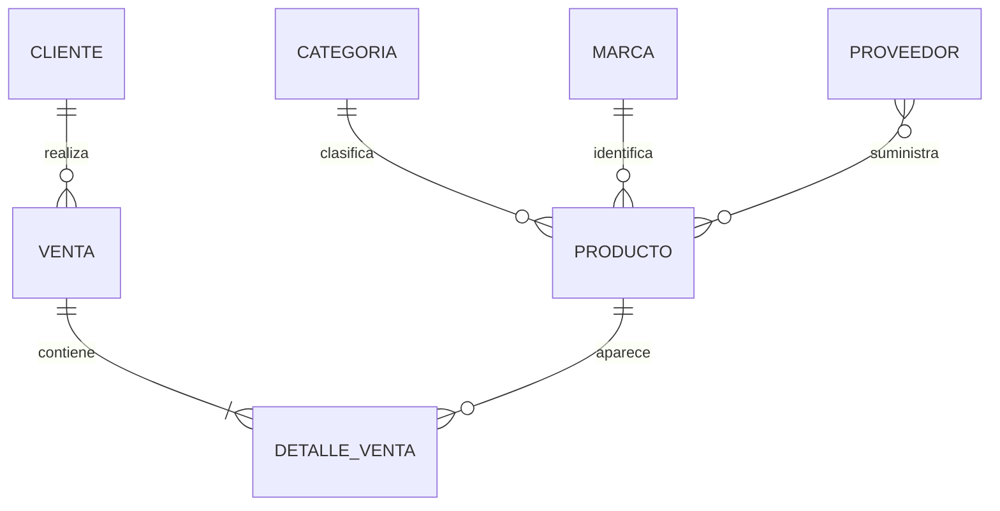

# Diseño conceptual

## Contexto y alcance

Una tienda vende computadoras portátiles y de escritorio a personas y empresas. Necesita conocer las especificaciones de cada configuración, sus proveedores, las existencias y el historial de ventas por cliente. El modelo cubre catálogo, relación de suministro y venta al cliente. Las compras a proveedores, pagos parciales, garantías, devoluciones parciales y comprobantes electrónicos quedan fuera de esta actividad.

## Entidades

| Entidad | Identificador | Atributos principales |
| --- | --- | --- |
| Categoría | categoria_id | Nombre y descripción |
| Marca | marca_id | Nombre |
| Producto / computadora | producto_id | SKU, nombre, especificaciones, precio, stock y estado activo |
| Proveedor | proveedor_id | RUC, razón social, contacto y estado activo |
| Cliente | cliente_id | Documento, nombre o razón social, contacto y estado activo |
| Venta | venta_id | Fecha, cliente, medio de pago, moneda, estado y anulación |
| Detalle de venta | venta_id + producto_id | Cantidad, precio histórico y subtotal |

`producto_proveedor` materializa la relación conceptual **suministra** y agrega el costo referencial de cada proveedor para cada computadora.

## Relaciones y cardinalidades

| Relación | Cardinalidad | Participación |
| --- | --- | --- |
| Categoría clasifica Producto | 1:N | Cada producto tiene una categoría; una categoría puede no tener productos |
| Marca identifica Producto | 1:N | Cada producto tiene una marca; una marca puede no tener productos |
| Proveedor suministra Producto | N:M | Ambos pueden existir sin suministro registrado; se resuelve con una tabla puente |
| Cliente realiza Venta | 1:N | Cada venta pertenece a un cliente; un cliente puede no comprar |
| Venta contiene Detalle | 1:N | Cada venta confirmada debe tener 1 a 100 líneas; cada detalle pertenece a una venta |
| Producto participa en Detalle | 1:N | Cada detalle corresponde a una computadora; un producto puede no haberse vendido |

La cantidad mínima de líneas por venta se garantiza al usar `registrar_venta`; una FK por sí sola no obliga a que una cabecera tenga hijos. El rol de aplicación no tiene permisos para insertar cabeceras o detalles directamente.

## DER

La imagen usa `1`, `0..N` y `1..100` para indicar participación. El DER expresa reglas del negocio; el modelo relacional muestra su implementación con claves y tabla puente. Editables: [SVG](diagramas/der_conceptual.svg), [Mermaid](diagramas/der_conceptual.mmd).

Mermaid representa `1..N` para los detalles; el límite exacto de 100 lo define la función. Las computadoras se manejan por configuración y unidades, sin seguimiento individual de números de serie.
